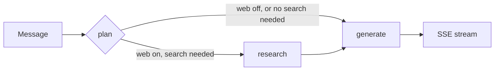
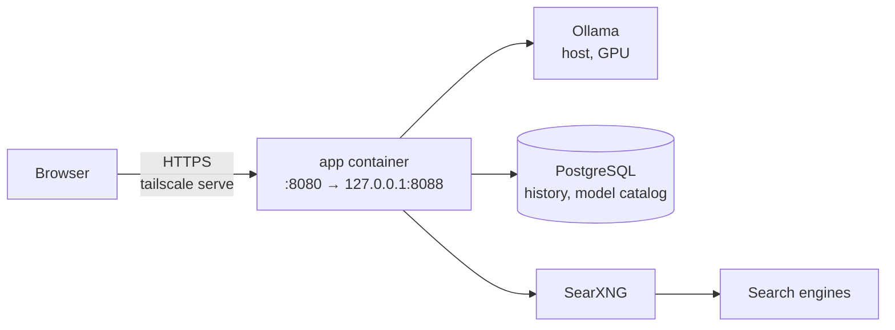

# Private LLM Chat

A self-hosted chat portal for local LLMs. Inference never leaves your machine.


## Overview

A ChatGPT-style web interface in front of models served by [Ollama](https://ollama.com). It adds a model picker with auto-generated descriptions, opt-in web search through a self-hosted [SearXNG](https://github.com/searxng/searxng) instance, and persistent conversation history. It is built for a single-GPU home server reached over a Tailscale tailnet.

## Features

- **Model picker with descriptions.** Generated automatically when a model appears in Ollama, including models pulled from the CLI.
- **Model management.** Pull and delete models from the UI, with download progress.
- **GPU memory control.** See which models are resident in VRAM and unload them on demand.
- **Web search toggle.** Off by default. Answers cite their sources as `[n]`.
- **Conversation history.** Resume, rename and delete. Long chats are summarized, not silently truncated.
- **Rich rendering.** Markdown, syntax-highlighted code and LaTeX via KaTeX, bundled locally with no CDN.
- **Streaming.** Separate reasoning trace for thinking models, tokens/s, and a stop button that keeps the partial answer.
- **Responsive UI.** Works on desktop and phone.

## How it works



1. **Pick a model.** The selector lists every installed chat model, each with a short description.
2. **Plan.** With the web toggle on, the selected model decides whether a search is needed. It writes 1 to 3 queries as structured JSON.
3. **Research.** Queries go to SearXNG. The top pages are downloaded and their main text is extracted.
4. **Rank.** Pages are split into passages. A local embedding model ranks them against the queries. Only the best passages enter the prompt.
5. **Fit the context.** Recent messages are sent verbatim. Older ones are folded into a rolling summary.
6. **Generate.** The answer streams token by token, with numbered citations when the web was used.

With the web toggle off, no part of the conversation leaves the server.

### Deployment



The app listens on port 8080 inside its container. Compose publishes it on the host at `127.0.0.1:${APP_PORT}` (default 8088), loopback only.

## Tech stack

| Component | Technology |
|---|---|
| Model serving | [Ollama](https://ollama.com), on the host GPU |
| Answer pipeline | [LangGraph](https://langchain-ai.github.io/langgraph/) |
| API and streaming (SSE) | [FastAPI](https://fastapi.tiangolo.com) |
| Persistence | [PostgreSQL](https://www.postgresql.org) through async [SQLAlchemy](https://www.sqlalchemy.org) |
| Web search | [SearXNG](https://github.com/searxng/searxng), self-hosted metasearch |
| Page text extraction | [trafilatura](https://trafilatura.readthedocs.io) |
| Passage ranking | [nomic-embed-text](https://ollama.com/library/nomic-embed-text) via Ollama |
| Frontend | [React](https://react.dev) + [Vite](https://vite.dev), [react-markdown](https://github.com/remarkjs/react-markdown), [highlight.js](https://highlightjs.org) |
| Deployment | Docker Compose, exposed with `tailscale serve` |

## Requirements

- Docker with Compose v2
- Ollama on the host, reachable from containers (see [Reaching Ollama from the container](#reaching-ollama-from-the-container))
- At least one chat model, e.g. `ollama pull qwen3:14b`
- Recommended: `ollama pull nomic-embed-text`, for passage ranking
- Tailscale, for access from other devices

> [!TIP]
> On a 16 GB GPU, models up to ~14B parameters at Q4/Q5 quantization fit entirely in VRAM with a comfortable context window.

## Getting started

### Install

```bash
git clone https://github.com/cassianorcarneiro/private-llm-chat.git /opt/private-llm-chat
cd /opt/private-llm-chat
cp .env.example .env
sed -i "s/^POSTGRES_PASSWORD=.*/POSTGRES_PASSWORD=$(openssl rand -hex 24)/" .env
sed -i "s/^SEARXNG_SECRET=.*/SEARXNG_SECRET=$(openssl rand -hex 32)/" .env
docker compose up -d --build
```

### Check

```bash
curl http://127.0.0.1:8088/api/health
# {"ollama": true, "searxng": true}
```

### Publish to your tailnet

```bash
sudo tailscale serve --bg --https=8443 http://127.0.0.1:8088
# → https://<host>.<tailnet>.ts.net:8443
```

### Reaching Ollama from the container

The app calls `http://host.docker.internal:11434`. Compose maps that name to the `docker0` bridge address, `172.17.0.1`. Ollama must listen there:

```bash
sudo systemctl edit ollama
# [Service]
# Environment="OLLAMA_HOST=172.17.0.1:11434"
sudo systemctl restart ollama
```

This keeps Ollama off the LAN and the tailnet. Compose networks use other subnets (`172.18.0.0/16` and up). If a host firewall is active, allow them:

```bash
sudo ufw allow from 172.16.0.0/12 to 172.17.0.1 port 11434 proto tcp
```

## Configuration

All settings are environment variables in `.env`. See [`.env.example`](.env.example).

| Variable | Default | Description |
|---|---|---|
| `POSTGRES_PASSWORD` | *(required)* | Database password |
| `SEARXNG_SECRET` | *(required)* | SearXNG secret key |
| `APP_PORT` | `8088` | Host port, bound to `127.0.0.1` |
| `OLLAMA_BASE_URL` | `http://host.docker.internal:11434` | Ollama endpoint |
| `TIMEZONE` | `America/Sao_Paulo` | Defines "today" in prompts |
| `DEFAULT_NUM_CTX` | `8192` | Context window sent to Ollama, capped by each model's limit |
| `KEEP_ALIVE` | `15m` | Time a model stays in VRAM after the last request |
| `EMBED_MODEL` | `nomic-embed-text` | Embedding model for passage ranking |
| `SEARCH_AUTHORITY_BOOST` | `0.15` | Ranking bonus for primary sources |
| `SEARCH_PRIMARY_DOMAINS` | code, package and paper hosts | JSON list of hosts treated as primary sources |
| `CATALOG_ENABLED` | `true` | Auto-describe installed models |
| `CATALOG_FETCH_REMOTE` | `true` | Fetch the model's public page to ground descriptions |
| `DESCRIBER_MODEL` | loaded model, else the model itself | Model that writes descriptions |
| `DESCRIPTION_LANGUAGE` | `English` | Language of descriptions, e.g. `Brazilian Portuguese` |

> [!NOTE]
> Ollama does not release VRAM to non-Ollama processes. If other CUDA jobs share the GPU, lower `KEEP_ALIVE` or unload models from the UI.

## Privacy

| Path | What leaves the server |
|---|---|
| Chat, web toggle off | Nothing |
| Chat, web toggle on | Search queries (rewritten by the model, not the raw prompt) and page requests. Search engines see your public IP. |
| New model installed | The model name only, sent to ollama.com or huggingface.co. Disable with `CATALOG_FETCH_REMOTE=false`. |

There is no telemetry. To hide your IP from search engines as well, route the SearXNG container through a VPN or proxy using SearXNG's `outgoing` settings.

## API

| Method | Path | Description |
|---|---|---|
| `POST` | `/api/chat` | SSE stream with events `meta`, `status`, `sources`, `thinking`, `token`, `stats`, `loop`, `notice`, `done`, `error` |
| `GET` | `/api/conversations` | List conversations |
| `GET` / `PATCH` / `DELETE` | `/api/conversations/{id}` | Read with messages, rename, delete |
| `GET` | `/api/models` | Installed models with metadata and descriptions |
| `POST` | `/api/models/pull` | Pull a model (SSE progress) |
| `POST` | `/api/models/{name}/describe` | Regenerate a description |
| `DELETE` | `/api/models/{name}` | Remove a model from Ollama |
| `GET` | `/api/models/loaded` | Models resident in memory (Ollama `/api/ps`) |
| `POST` | `/api/models/unload` | Unload one model (`{"name": ...}`) or all (`{}`) |
| `GET` | `/api/health` | Ollama and SearXNG reachability |

## Design decisions

### Ollama, not vLLM

vLLM pre-allocates GPU memory and serves one model per process. It optimizes throughput under many concurrent requests. A single user switching models on one GPU benefits more from Ollama's on-demand loading and unloading (`keep_alive`).

### The planner runs on the selected model

That model is already resident in VRAM, so deciding whether to search costs no model swap. A separate router model would force an unload and reload on every turn on a 16 GB card. The planner uses Ollama structured outputs (JSON schema). If it fails, the app searches the raw message.

### Fetch and rerank, not snippets

Search-engine snippets are too short to ground an answer. Pages are downloaded with a size cap and their main text is extracted. Each passage is scored by its maximum cosine similarity to any query. Passages below 60 % of the best score are dropped, and at most two are kept per page. Without an embedding model, ranking falls back to lexical overlap.

### Relevance is not reliability

An SEO article titled "Latest version of X" can match a question better than the project's own release page, and be weeks out of date. Three mechanisms counter that:

- **Query language.** The planner writes queries in the language most likely to reach primary sources, such as English for software and science.
- **Authority prior.** Primary sources get a multiplicative bonus, $(1 + 0.15) \times \text{similarity}$. The bonus only reorders passages of comparable relevance. A source is primary if its host is a code, package or paper host (`github.com`, `pypi.org`, `arxiv.org`, …), or if its registrable domain name equals a query term: `ollama.com` qualifies for "ollama …", `ollama-guide.net` does not. Up to two primary hits beyond the top 5 are also fetched, since engines often rank them lower.
- **Dates in context.** Each passage header carries its site, publication date from page metadata and a primary-source flag. The model is told to prefer the most recent primary source when results disagree, and to state the disagreement.

### Web content is untrusted

Retrieved text is wrapped in delimiters with an explicit instruction to treat it as data. The app takes no actions, so a prompt injection can only affect the answer text.

### `num_ctx` is always explicit

Ollama's default context is small and truncates silently. The app sends `min(DEFAULT_NUM_CTX, model limit)` and fits the history to that budget:

```
history budget = num_ctx − response reserve − system prompt − user message − web context
```

Messages that no longer fit are merged into a rolling summary (previous summary + evicted messages), so each turn's cost stays bounded. The window always starts on a user turn, because some chat templates reject a history that opens with an assistant message.

### Runaway generation is stopped by the server

Small models sometimes fall into a repetition loop and copy their last block until the context is full. Ollama's repetition penalty only looks at the last 64 tokens by default, so a loop with a longer period goes unpenalized. Two model-independent guards apply:

- **Output cap.** `num_predict` is set to the room left in the context window. Without it, Ollama keeps generating by discarding old tokens, and a looping model never stops.
- **Loop detector.** Every 48 characters, the tail of the answer is checked for a block repeated at equal spacing at least four times, using a 160-character probe. Digits are masked for long blocks, because loops often increment a counter (`[85]`, `[86]`, …). On a match, the server closes the stream, which stops Ollama, and keeps exactly one copy of the block, so the stored answer does not poison later turns. The probe must contain at least 12 distinct characters, so separators and tables of bare numbers do not match. Three copies of a paragraph, as in "repeat this three times", do not match either.

### History in relational tables, not the LangGraph checkpointer

The checkpointer stores opaque per-step graph state. The UI must list, rename and delete conversations, which is domain data. LangGraph is used for what it adds: typed state, conditional edges and a streaming channel for node events.

### Grounded model descriptions

Ollama has no API for "what is this model good at". An LLM describing a model from its own weights would hallucinate, because most models are newer than its training data. So `/api/show` provides objective metadata, the model's public page provides the author's claims, and a local LLM only condenses the two.

### Level-triggered model detection

Ollama has no webhooks. A reconciliation loop diffs `/api/tags` against the catalog every 60 seconds. This also covers models pulled from the CLI, not only those pulled through the UI.

## Limitations

- **Single user.** There is no app-level authentication; the tailnet is the access control. Do not publish the port to the LAN or the internet.
- **Local model quality.** Models that fit in 16 GB do well on everyday tasks but trail commercial models on long reasoning.
- **Search depends on public engines.** Any of the engines SearXNG aggregates can rate-limit or block it.
- **Source authority is a heuristic.** Name matching misses official sites on unrelated domains, and dates are only as good as page metadata.
- **Estimated token counts.** The budget assumes ~3 characters per token. This errs on the safe side but wastes some context.
- **No schema migrations.** Tables are created with `create_all`. Add Alembic before changing the models.
- **Text only.** No file uploads or image input yet, even for vision models.

## Project structure

```
private-llm-chat/
├── backend/
│   ├── app/
│   │   ├── main.py            # FastAPI routes, SSE streaming, static files
│   │   ├── graph.py           # LangGraph pipeline: plan → research → generate
│   │   ├── search.py          # SearXNG, page fetch, extraction, chunking, ranking
│   │   ├── memory.py          # Token budget, sliding window, rolling summary
│   │   ├── loopguard.py       # Repetition-loop detection on streamed output
│   │   ├── catalog.py         # Model description reconciliation loop
│   │   ├── ollama_client.py   # Async Ollama API client
│   │   ├── prompts.py         # Prompt templates
│   │   ├── db.py              # SQLAlchemy models
│   │   └── config.py          # Settings from the environment
│   └── requirements.txt
├── frontend/
│   ├── src/
│   │   ├── App.tsx            # State, chat streaming
│   │   ├── api.ts             # REST client and SSE parser
│   │   └── components/        # Sidebar, MessageView, Composer, ModelManager
│   └── package.json
├── searxng/
│   └── settings.yml           # Internal-only instance, JSON API enabled
├── Dockerfile                 # Multi-stage: Node build → Python runtime
├── docker-compose.yml         # app + postgres + searxng
├── .env.example
├── LICENSE
└── README.md
```

## Development

Backend, with SQLite for local runs:

```bash
cd backend
python -m venv .venv && . .venv/bin/activate
pip install -r requirements.txt aiosqlite
DATABASE_URL=sqlite+aiosqlite:///dev.db \
OLLAMA_BASE_URL=http://localhost:11434 \
SEARXNG_URL=http://localhost:8081 \
uvicorn app.main:app --reload --port 8080
```

Frontend, which proxies `/api` to port 8080:

```bash
cd frontend
npm install
npm run dev
```

## Roadmap

- [x] Streaming chat with persistent history
- [x] Model picker with grounded, auto-generated descriptions
- [x] Opt-in web search with citations
- [x] Rolling summary for long conversations
- [ ] Image input for vision models
- [ ] Document upload with local RAG
- [ ] Edit and regenerate messages
- [ ] Exact token counting with the model's tokenizer
- [ ] Alembic migrations

## License

Released under the [MIT License](LICENSE).

## Author

**Cassiano Ribeiro Carneiro** · [@cassianorcarneiro](https://github.com/cassianorcarneiro)

## AI assistance

This project was designed and implemented with Claude (Anthropic). The author defined the requirements, made the architecture and technology decisions, and reviewed the result.
